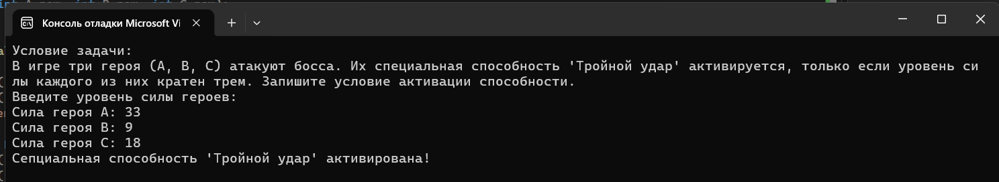

# Домашнее задание к работе 4

## Условия задачи
В игре три героя (A, B, C) атакуют босса. Их специальная способность "Тройной удар" активируется, только если уровень силы каждого из них кратен трем. Запишите условие активации способности.

## Результаты работы программы

## Информация о разработчике
Орлова Эльвира Эдуардовна
Группа: бИД-261
